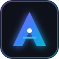

# 🚀 Antigravity Discord RPC

<p align="center">
  
</p>

<p align="center">
  <strong>Real-time Discord Rich Presence for Antigravity & VS Code</strong><br>
  Broadcast live agent reasoning, lifetime tokens, daily output, coding streaks, and active projects straight into your Discord profile card with zero configuration.
</p>

<p align="center">
  <a href="https://github.com/A-Gift-Of-Flame/antigravity-rpc/releases"></a>
  <a href="LICENSE"></a>
  <a href="https://antigravity-rpc.com"></a>
</p>

---

## ✨ Features

- **⚡ Zero Configuration**: Connects natively to local Discord desktop client via Windows Named Pipes & Unix sockets. No bot tokens, OAuth logins, or setup headaches.
- **🔒 100% Local & Privacy-First**: Reads tokens and streaks directly from your local Antigravity SQLite database (`conversation_summaries.db`). Zero telemetry, zero external cloud servers.
- **💎 Real Token Flex**: Displays real lifetime tokens (e.g., `2.7B`), today's token volume (`+1.3B`), and consecutive streak days.
- **🧠 Live Agent State Tracking**: Shows whether Antigravity is `🧠 Reasoning (Gemini 3.8 Flash)`, `📝 Editing file.js`, `🐚 Running terminal tests`, or `💤 Idle`.
- **🎨 Dynamic Cycling Animations**: Smoothly alternates presence cards between project info, token flex, active file, and high-reasoning speed metrics.
- **💻 Dual Mode**: Run directly as an integrated **VS Code Extension** or standalone via the **CLI tool (`agy-rpc`)**.

---

## 📦 Quick Installation

### Windows (PowerShell One-Liner)
```powershell
irm https://antigravity-rpc.com/install.ps1 | iex
```

### Linux / macOS (Bash One-Liner)
```bash
curl -fsSL https://antigravity-rpc.com/install.sh | bash
```

### Via npx / npm
```bash
npx antigravity-rpc setup
```
or run directly:
```bash
npx antigravity-rpc run
```

---

## 🧩 VS Code Extension

1. Clone or download this repo.
2. Run `node cli/bin/agy-rpc.js setup` or copy `extension/` into:
   - Windows: `%USERPROFILE%\.vscode\extensions\antigravity.antigravity-rpc-1.0.0`
   - Linux/macOS: `~/.vscode/extensions/antigravity.antigravity-rpc-1.0.0`
3. Reload VS Code (`Ctrl+Shift+P` -> `Developer: Reload Window`).
4. Look at your status bar: `$(broadcast) Antigravity RPC: Active`!

### Extension Settings

Open VS Code Settings (`Ctrl+,`) and search for `antigravityRpc`:

| Setting | Default | Description |
|---|---|---|
| `antigravityRpc.enabled` | `true` | Enable / disable Discord Rich Presence |
| `antigravityRpc.animationMode` | `true` | Dynamic rotating status frames |
| `antigravityRpc.updateInterval` | `3` | Refresh interval in seconds |
| `antigravityRpc.button1Label` | `Antigravity AI` | Top button label |
| `antigravityRpc.button1Url` | `https://github.com/...` | Top button link |
| `antigravityRpc.button2Label` | `Discord RPC` | Bottom button label |
| `antigravityRpc.button2Url` | `https://antigravity-rpc.com`| Bottom button link |
| `antigravityRpc.customFlexTokens`| `""` | Optional manual override string |

---

## 🖥️ CLI Commands

```bash
agy-rpc run       # Start live terminal monitor & Discord presence
agy-rpc status    # Print current session metrics & token counts
agy-rpc start     # Launch daemon in background
agy-rpc stop      # Kill background daemon
agy-rpc setup     # Install VS Code extension and verify pipe connection
```

---

## 🌐 Website & Interactive Simulator

Open `website/index.html` in any browser to test the interactive Discord profile simulator inspired by `claude-rpc.com`!

---

## 📄 License

MIT © [A-Gift-Of-Flame](https://github.com/A-Gift-Of-Flame)

